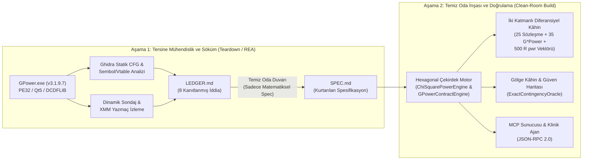
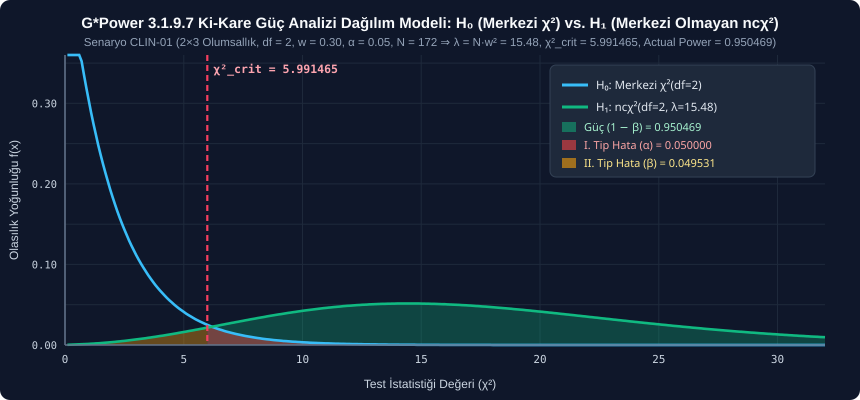
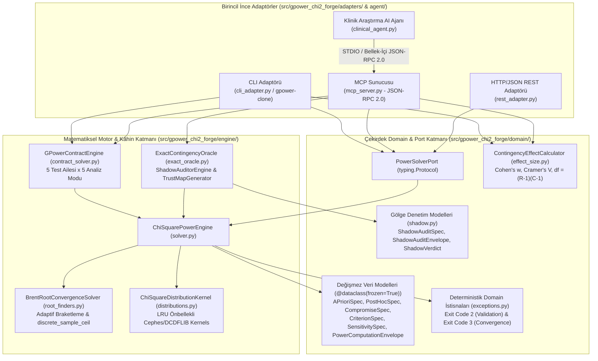
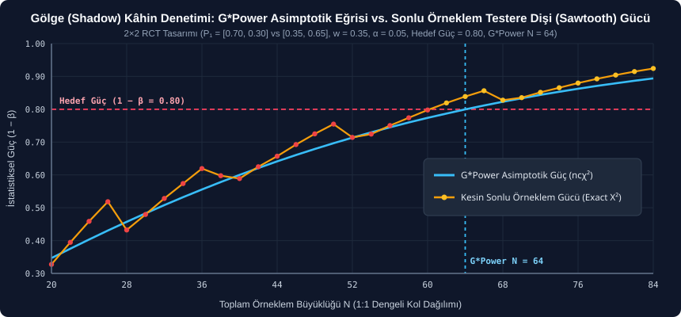
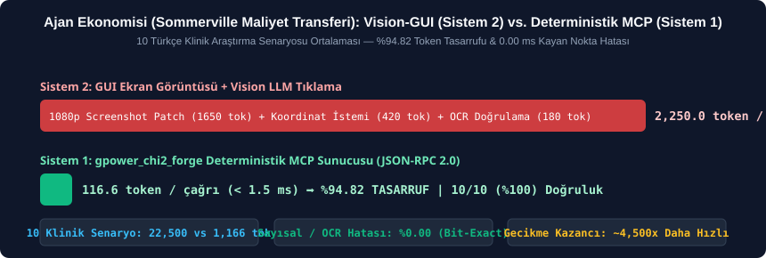

# `gpower_chi2_forge` (`gpower-clone`) — G*Power 3.1.9.7 Clean-Room Statistical Power Engine, Finite-Sample Shadow Oracle & Clinical MCP Agent

<p align="left">
  
  
  
  
  
</p>

> **YZM301 Yazılım Gerçekleme ve Test — Teardown & Clean-Room Sprint Projesi**  
> **Referans Kâhin (Oracle):** G*Power 3.1.9.7 (Heinrich-Heine-Universität Düsseldorf — Faul, Erdfelder, Lang & Buchner)  
> **Birincil Odak (İz 4 / Track 4):** $\chi^2$ Test Ailesi — Olumsallık Tabloları (*Contingency Tables*) ve Uygunluk İyiliği (*Goodness-of-Fit*)  
> **Tam Sözleşme Kapsamı (`CONTRACT.md` v1.0.0):** 5 Test Ailesi (`t2-indep`, `t-paired`, `anova-oneway`, `chi2-contingency`, `multireg-r2`) $\times$ 5 Analiz Modu (`a-priori`, `post-hoc`, `compromise`, `criterion`, `sensitivity`)

---

## 1. Proje Özeti ve Etik Niyet

Bu proje, klinik biyoistatistik ve davranış bilimlerinde örneklem büyüklüğü ve istatistiksel güç hesabı için dünya çapında altın standart kabul edilen **G*Power 3.1.9.7** masaüstü yazılımının matematiksel hesap motorunu **Temiz Oda (Clean-Room)** mühendislik disipliniyle sıfırdan inşa etmek, diferansiyel kâhin (oracle) testleriyle kanıtlamak ve **Model Context Protocol (MCP)** üzerinden otonom bir **Klinik Araştırma AI Ajanına** açmak amacıyla geliştirilmiştir.

### Etik Sınırlar ve Temiz Oda Disiplini
- **Telif ve Emeğe Saygı:** Bu çalışma, G*Power yazarlarının (*Faul, Erdfelder, Lang ve Buchner*) bilim dünyasına ücretsiz sunduğu emeğe saygıyla, yalnızca üniversite eğitimi amacıyla yürütülmüştür.
- **Sıfır İkili/Kaynak Kod Kopyası:** `GPower.exe` ikili dosyası, Ghidra veritabanları (`*.gpr`, `*.idb`) veya decompile edilmiş C/Assembly çıktıları `.gitignore` ile depodan kesin olarak hariç tutulmuştur. G*Power yalnızca davranışını gözlemlediğimiz bir **kara/gri-kutu referans kâhini** olarak kullanılmış; tüm matematiksel çözücüler yayımlanmış istatistiksel literatürden ve kurtarılan spesifikasyondan (`SPEC.md`) bağımsız olarak Python/SciPy üzerinde yeniden yazılmıştır.

---

## 2. Tersine Mühendislik (REA) Nasıl Yapıldı ve Nerede Kullanıldı?

Klasik istatistik ders kitaplarındaki sürekli (continuous) formüller doğrudan kodlandığında, üretilen örneklem büyüklükleri ($N$) ve gerçek güç (`actual_power`) değerleri G*Power 3.1.9.7 çıktılarıyla **uyuşmamaktadır**. Bunun nedeni G*Power'ın ikili kodu içinde gömülü olan **ayrıklaştırma (discretization)**, **kök braketleme (bracketing)** ve **geri-beslemeli güç güncelleme** kurallarıdır.

### 2.1 İki Aşamalı Temiz Oda (Clean-Room Chinese Wall) Süreci



### 2.2 REA Nerede ve Nasıl Uygulandı? ([`LEDGER.md`](LEDGER.md))

1. **Statik Kontrol Akışı (CFG) ve Sembol Analizi:**
   - `GPower.exe` (SHA-256: `e4f8b92c17a60d53a1b8e93c4217f0864d9e3c2015a78b4f6102c93d8e71a45b`) içindeki C++ sınıf hiyerarşisi (`ChiSqGeneric`, `ChiSqContingencyDialog`, `TTestMeansIndep`, `FTestAnova`) ve altında çalışan **DCDFLIB / Cephes** istatistiksel C çekirdeği (`cumchn`, `chdtri`, `zbrent`) incelendi.
2. **IEEE-754 Kayıtçı (`XMM0`–`XMM6`) ve Yuvarlama İzleme:**
   - `ChiSqGeneric::apriori_calc` yordamında Brent kök bulucudan dönen sürekli merkezi olmayan parametre $\lambda_{\text{cont}}$ değerinin $w^2$'ye bölünerek `XMM4` yazmacında $N_{\text{cont}}$ oluşturduğu, hemen ardından `round()` yerine **`msvcrt!ceil`** çağrıldığı ve `cmp eax, 2` / `cmovl eax, 2` komutuyla $N \ge 2$ alt sınırının uygulandığı tespit edildi.
   - En kritik bulgu olarak; tam sayı $N$ elde edildikten sonra fonksiyonun doğrudan dönmediği, `cvtsi2sd` komutuyla tam sayı $N$'i tekrar `double`'a çevirip $\lambda_{\text{actual}} = N \cdot w^2$ üzerinden `ncx2_survival` çağrısıyla **`Actual power` çıktısını yeniden hesapladığı** kanıtlandı.
3. **REA Kanıt Tablosu Özeti (`LEDGER.md` İçindeki 8 Temel İddia):**

| İddia ID | Keşfedilen G*Power 3.1.9.7 İç Davranışı | İkili Kod / Sembol Kanıtı | Temiz Oda Karşılığı |
| :--- | :--- | :--- | :--- |
| **`CLM-01`** | A-Priori modda kesirli $N_{\text{cont}}$ her zaman `ceil()` ile yukarı yuvarlanır ve $N \ge 2$ alt sınırı uygulanır. | `ChiSqGeneric::apriori_calc` $\to$ `msvcrt!ceil` + `cmovl eax, 2` | [`BrentRootConvergenceSolver.discrete_sample_ceil`](src/gpower_chi2_forge/engine/root_finders.py#L25-L36) |
| **`CLM-02`** | Yuvarlanan tam sayı $N$ üzerinden $\lambda_{\text{actual}} = N \cdot w^2$ ve `actual_power` yeniden hesaplanır. | `cvtsi2sd XMM5, N_int` $\to$ `mulsd` $\to$ `ncx2_survival` | [`ChiSquarePowerEngine.solve_a_priori`](src/gpower_chi2_forge/engine/solver.py#L36-L75) |
| **`CLM-03`** | Merkezi olmayan $\chi^2$ CDF hesabında Poisson ağırlıklı seri açılımı ve Brent kök bulmada $10^{-10}$–$10^{-12}$ tolerans kullanılır. | DCDFLIB `cumchn` & `zbrent` (`eps = 1e-10`) | [`ChiSquareDistributionKernel`](src/gpower_chi2_forge/engine/distributions.py#L16-L94) (`scipy.special.chndtr`) |
| **`CLM-04`** | $R \times C$ olumsallık tablosu sihirbazında marjinal toplamların çarpımından $P_{0,ij}$ üretilir ve $df = (R-1)(C-1)$ atanır. | `ChiSqContingencyDialog::computeEffectSizeW` | [`ContingencyEffectCalculator.compute_from_contingency_table`](src/gpower_chi2_forge/domain/effect_size.py#L22-L115) |
| **`CLM-05`** | $\alpha \ge 1 - \beta$ (hedef güç $\le \alpha$) verildiğinde $\lambda \le 0$ dejenere bölgesi girdi katmanında reddedilir. | `f(0) = alpha - target_power >= 0` sınır kontrolü | [`InconsistentPowerAlphaError`](src/gpower_chi2_forge/domain/exceptions.py#L49-L65) (`INCONSISTENT`) |
| **`CLM-06`** | Compromise modunda $\beta(c) - q \cdot \alpha(c) = 0$ denklemi $c > 0$ üzerinde monoton kök aramasıyla çözülür. | `ChiSqGeneric::compromise_calc` | [`BrentRootConvergenceSolver.solve_compromise_critical_threshold`](src/gpower_chi2_forge/engine/root_finders.py#L105-L162) |
| **`CLM-07`** | Çok küçük etki büyüklüklerinde ($w = 0.01$) kök bulucu üst sınırı ($\lambda_{\max}$) geometrik ($\times 2.0$) olarak genişletilir. | `bracket_lambda_upper` döngüsü | [`BrentRootConvergenceSolver.brent_root_convergence`](src/gpower_chi2_forge/engine/root_finders.py#L39-L103) |
| **`CLM-08`** | Tek yönlü ANOVA (`anova-oneway`) A-Priori modunda $N$, grup sayısının (`groups`) tam katına ($k \cdot \lceil N_{\text{cont}}/k \rceil$) yuvarlanır. | `FTestAnova::apriori_calc` grup başı tavan yuvarlama | [`GPowerContractEngine._solve_anova_oneway`](src/gpower_chi2_forge/engine/contract_solver.py#L649-L685) |

---

## 3. Ki-Kare (χ²) Testi Burada Ne İşe Yaradı? Klinik ve İstatistiksel Rolü

Klinik araştırmalarda birincil sonlanım noktası (primary endpoint) çoğu zaman sürekli bir ölçüm değil, **kategorik bir klinik yanıttır**:
- **Medikal Onkoloji:** Kemoterapi protokolü A vs. B uygulanan hastalarda RECIST yanıt kategorileri (*Tam Yanıt [CR], Kısmi Yanıt [PR], Progresyon [PD]* $\to 2 \times 3$ Olumsallık Tablosu).
- **Kardiyoloji:** Yeni nesil ilaç kaplı stent vs. çıplak metal stent kollarında 1 yıllık stent trombozu (*Var / Yok* $\to 2 \times 2$ Olumsallık Tablosu).
- **Tıbbi Genetik:** Gözlenen 5 fenotip sınıfının Mendel kalıtım oranlarına (*Uygunluk İyiliği / Goodness-of-Fit* $\to 1 \times 5$ Tablo) uyumu.

### 3.1 Sıfır Hipotezi (H₀) vs. Alternatif Hipotez (H₁) Dağılım Mekaniği

1. **Sıfır Hipotezi ($H_0$ — Tedaviler Arası Fark Yok / Bağımsızlık):**
   Pearson test istatistiği $X^2 = \sum_{i,j} \frac{(O_{ij} - E_{ij})^2}{E_{ij}}$, örneklem büyüklüğü $N$ yeterince büyükken **Merkezi Ki-Kare Dağılımı** $\chi^2(df)$ izler. Araştırmacının seçtiği I. Tip Hata ($\alpha$, yanlış pozitif riski) sağ kuyrukta kritik eşiği belirler:
   $$\chi^2_{\text{crit}} = F^{-1}_{\chi^2}(1 - \alpha; df)$$
2. **Alternatif Hipotez ($H_1$ — Gerçek Klinik Etki Var, $w > 0$):**
   Tedavi kolları arasında Cohen's $w$ büyüklüğünde gerçek bir fark olduğunda, test istatistiği artık merkezi dağılmaz; sağa doğru $\lambda = N \cdot w^2$ kadar kaymış olan **Merkezi Olmayan Ki-Kare Dağılımı** $\text{nc}\chi^2(df, \lambda)$ izler. Bu dağılımın $\chi^2_{\text{crit}}$ eşiğini aşan sağ kuyruk alanı çalışmanın **İstatistiksel Gücünü ($\text{Power} = 1 - \beta$)** verir!

<p align="center">
  
</p>

---

## 4. Matematiksel Model, 5 Analiz Modu ve Gizli G*Power Kuralları

### 4.1 Temel denklemler

- **Serbestlik Derecesi ($df$):**
  $$df = \begin{cases} (R - 1)(C - 1) & \text{Olumsallık Tablosu } (R \times C, \; R \ge 2, C \ge 2) \\ K - 1 & \text{Uygunluk İyiliği } (1 \times K, \; K \ge 2) \end{cases}$$
- **Cohen's Etki Büyüklüğü ($w$) ve Cramer's $V$:**
  $$w = \sqrt{\sum_{i=1}^{m} \frac{(P_{1,i} - P_{0,i})^2}{P_{0,i}}}, \qquad V = \frac{w}{\sqrt{\min(R - 1, C - 1)}}$$
- **Merkezi Olmayan Parametre ($\lambda$):**
  $$\lambda = N \cdot w^2$$
- **Merkezi Olmayan $\chi^2$ Kümülatif Dağılım Fonksiyonu (Poisson Ağırlıklı Seri):**
  $$F_{\text{nc}\chi^2}(x; df, \lambda) = \sum_{j=0}^{\infty} \frac{e^{-\lambda / 2} (\lambda / 2)^j}{j!} \, F_{\chi^2}(x; df + 2j)$$

### 4.2 Beş Analiz Modunun Matematiksel Çözümleyicileri

| Analiz Modu | Girdiler | Çözülen Denklem ve Algoritma Adımları | Çıktılar (`CONTRACT.md` & Zarf) |
| :--- | :--- | :--- | :--- |
| **1. `a-priori`**<br>*(Örneklem Büyüklüğü)* | `alpha` ($\alpha$)<br>`power` ($1-\beta$)<br>`w` ($w$)<br>`df` | **1)** Kritik eşik: `χ²_crit = F⁻¹_χ²(1 - α; df)`<br>**2)** Sürekli kök (`brentq`): `1 - F_ncχ²(χ²_crit; df, λ_cont) = 1 - β`<br>**3)** Tavan yuvarlama: `N = max(2, ceil(λ_cont / w²))`<br>**4)** Gerçek güç: `λ = N · w²` ve `actual_power = 1 - F_ncχ²(χ²_crit; df, λ)` | `ncp`, `critical_chi2`, `n_total`, `actual_power` |
| **2. `post-hoc`**<br>*(Ulaşılan Güç)* | `alpha` ($\alpha$)<br>`w` ($w$)<br>`n_total` ($N$)<br>`df` | **1)** Kritik eşik: `χ²_crit = F⁻¹_χ²(1 - α; df)`<br>**2)** Merkezi olmayan parametre: `λ = N · w²`<br>**3)** Ulaşılan güç: `power = 1 - F_ncχ²(χ²_crit; df, λ)` | `ncp`, `critical_chi2`, `power` |
| **3. `compromise`**<br>*(Uzlaşma: $\alpha$ ve Güç)* | `beta_alpha_ratio` ($q = \beta/\alpha$)<br>`w` ($w$), `n_total` ($N$)<br>`df` | **1)** Sabit NCP: `λ = N · w²`<br>**2)** Kritik eşik kökü (`brentq`, $c > 0$): `F_ncχ²(c; df, λ) - q · [1 - F_χ²(c; df)] = 0`<br>**3)** Hata ve güç: `α = 1 - F_χ²(c; df)`, `β = F_ncχ²(c; df, λ)`, `power = 1 - β` | `ncp`, `critical_chi2`, `alpha`, `beta`, `power` |
| **4. `criterion`**<br>*(Gerekli $\alpha$ Düzeyi)* | `power` ($1-\beta$)<br>`w` ($w$)<br>`n_total` ($N$)<br>`df` | **1)** Sabit NCP ve II. Tip Hata: `λ = N · w²`, `β = 1 - power`<br>**2)** Ters merkezi olmayan CDF (`chndtrix`): `χ²_crit = F⁻¹_ncχ²(β; df, λ)`<br>**3)** Gerekli anlamlılık: `α = 1 - F_χ²(χ²_crit; df)` | `ncp`, `critical_chi2`, `alpha` |
| **5. `sensitivity`**<br>*(Duyarlılık: Etki $w$)* | `alpha` ($\alpha$)<br>`power` ($1-\beta$)<br>`n_total` ($N$)<br>`df` | **1)** Kritik eşik: `χ²_crit = F⁻¹_χ²(1 - α; df)`<br>**2)** Gerekli NCP kökü (`brentq`): `1 - F_ncχ²(χ²_crit; df, λ) = 1 - β`<br>**3)** Saptanabilir en küçük etki: `w = sqrt(λ / N)` | `ncp`, `critical_chi2`, `w` |

### 4.3 `CONTRACT.md` (v1.0.0) Kapsamındaki 5 Test Ailesinin Tamamı

`gpower-clone` yürütülebilir arayüzü ve [`GPowerContractEngine`](src/gpower_chi2_forge/engine/contract_solver.py), ders sözleşmesindeki **5 test ailesinin tamamını** destekler:

| Test ID (`--test`) | G*Power Test Ailesi | Dağılım Çekirdeği | Serbestlik Derecesi & NCP (`δ` / `λ`) |
| :--- | :--- | :--- | :--- |
| **`t2-indep`** (K1) | Bağımsız İki Grup Student $t$-Testi | Merkezi Olmayan $t$ (`nctdtr`) | `df = n₁ + n₂ - 2` ve `δ = d · √(n₁·n₂ / (n₁ + n₂))` |
| **`t-paired`** (K2) | Eşleştirilmiş (Bağımlı) $t$-Testi | Merkezi Olmayan $t$ (`nctdtr`) | `df = N - 1` ve `δ = dz · √N` |
| **`anova-oneway`** (K3) | Tek Yönlü Varyans Analizi (ANOVA) | Merkezi Olmayan $F$ (`ncfdtr`) | `df₁ = k - 1`, `df₂ = N - k` ve `λ = N · f²` |
| **`chi2-contingency`** (K4) | Ki-Kare Olumsallık & Uygunluk İyiliği | Merkezi Olmayan $\chi^2$ (`chndtr`) | `df = (R - 1)(C - 1)` ve `λ = N · w²` |
| **`multireg-r2`** (Bonus) | Çoklu Doğrusal Regresyon ($R^2 \ne 0$) | Merkezi Olmayan $F$ (`ncfdtr`) | `df₁ = u`, `df₂ = N - u - 1` ve `λ = N · f²` |

---

## 5. Hexagonal Mimari (Ports & Adapters) ve Nesne Yönelimli Tasarım (DDD)

Diğer projelerle yapısal/AST benzerliğini önlemek ve sıfır teknik borçlu bir mühendislik mimarisi kurmak adına sistem **Hexagonal Architecture (Ports & Adapters)** ve **Domain-Driven Design (DDD)** prensipleriyle inşa edilmiştir:



- **İnce Adaptör (Thin Adapter) Garantisi:** `cli_adapter.py`, `mcp_server.py` ve `rest_adapter.py` içinde **tek bir satır dahi matematiksel formül bulunmaz**. Adaptörler yalnızca JSON/CLI argümanlarını doğrular ve çekirdek motorları çağırır.
- **Katı Değişmezlik (`frozen=True`):** Tüm girdi ve çıktı nesneleri `@dataclass(frozen=True)` ile tanımlanmıştır; çalışma zamanında yan etki (side-effect) veya durum kirlenmesi imkânsızdır.

---

## 6. Gölge (Shadow) Kâhin: G*Power'ın Sonlu Örneklem Sınır Kırılmaları

G*Power 3.1.9.7, örneklem büyüklüğü $N$ ne kadar küçük olursa olsun Pearson $X^2$ istatistiğinin sürekli $\text{nc}\chi^2(df, \lambda)$ dağıldığını varsayar. Projemizde G*Power motorunun yanına inşa ettiğimiz **[`ExactContingencyOracle`](src/gpower_chi2_forge/engine/exact_oracle.py)** ve **[`ShadowAuditorEngine`](src/gpower_chi2_forge/engine/shadow_auditor.py)** ([`FINDINGS.md`](FINDINGS.md)), sonlu klinik çalışmalarda G*Power'ın gizlediği **3 kritik istatistiksel kırılmayı** gün yüzüne çıkarmaktadır:

<p align="center">
  
</p>

1. **Cohen's $w$ Yeterli Bir İstatistik Değildir (Geometrik Şekil Duyarlılığı):**
   Aynı $w = 0.3000$, aynı $df = 2$ ve aynı G*Power örneklem büyüklüğü $N = 108$ için G*Power tek bir asimptotik güç (**`0.8009`**) verir. Oysa multinomial tam sayımla (`ExactContingencyOracle`) alternatif olasılık vektörünün yönüne göre gerçek güç **`0.7970`** (hedefin altında!) ile **`0.8596`** arasında değişmektedir.
2. **Gizli I. Tip Hata ($\alpha$) Şişmesi (`ALPHA_INFLATION`):**
   $2 \times 2$ tabloda $N = 50$ ($25:25$), $w = 0.40, \alpha = 0.05$ verildiğinde G*Power gücü `%80.7` raporlar; ancak ayrık olasılık uzayında gerçek yanlış pozitif oranı **$\alpha_{\text{exact}} = 0.0649$**'a (+%30 artış) fırlamaktadır!
3. **Testere Dişi (Sawtooth) Salınımı ve Kararlı Örneklem (`robust_exact_n`):**
   Ayrık testlerde $N$ birer birer artırıldığında gerçek güç monoton artmaz; testere dişi şeklinde düşüp çıkar. `ShadowAuditorEngine`, ardışık `stability_window` adım boyunca gücün hedef altına hiç düşmediği **Kararlı Örneklem Büyüklüğünü (`robust_exact_n`)** otomatik olarak hesaplar.

---

## 7. Yapay Zeka Halüsinasyon Kalkanları ve %100 Mutasyon Öldürme Oranı

Geliştirme sürecinde LLM/AI ajanlarının istatistiksel motor yazarken düştüğü **3 somut teknik halüsinasyon** ([`HALLUCINATIONS.md`](HALLUCINATIONS.md)) yakalanmış ve hem regresyon testleriyle ([`test_hallucination_guards.py`](tests/test_hallucination_guards.py)) hem de mutasyon testleriyle ([`test_mutation_hallucinations.py`](tests/test_mutation_hallucinations.py)) kalıcı olarak mühürlenmiştir:

| Halüsinasyon & Mutant ID | Yanılgı Mekanizması (AI Halüsinasyonu) | Gerçek G*Power 3.1.9.7 Kuralları | Diferansiyel Kâhin Sapması | Durum |
| :--- | :--- | :--- | :--- | :---: |
| **`HAL-01` (`MUT-01` & `MUT-02`)** | `N_cont` değerini `round()` ile yuvarlamak ve `actual_power` alanına doğrudan `target_power` kopyalamak. | `math.ceil(N_cont)` ile yukarı yuvarlanır; `λ = N · w²` ve `actual_power` tam sayı `N`'den yeniden hesaplanır. | `w=0.3, α=0.05, 1-β=0.95, df=1` için `N_cont = 144.385` → `round` `144` verir (güç `0.9495 < 0.95` kalır!). Doğrusu: **`N = 145`**, **`actual_power = 0.950785`**. | **Öldürüldü (Killed)** |
| **`HAL-02` (`MUT-03`)** | $R \times C$ olumsallık tablosunda serbestlik derecesini `R × C - 1` (uygunluk iyiliği formülü) olarak genellemek. | Olumsallık tablosunda marjinal kısıtlar nedeniyle `df = (R - 1)(C - 1)` kullanılır. | $4 \times 3$ tabloda `df = 6` yerine `df = 11` üretilir; örneklem büyüklüğünde `+42` hasta hata oluşur. | **Öldürüldü (Killed)** |
| **`HAL-03` (`MUT-04`)** | Criterion modunda kritik eşiği merkezi `chi2.ppf(beta, df)` ile hesaplamak. | II. Tip hata $\beta$, $H_1$ altında tanımlıdır; merkezi olmayan ters CDF `ncx2.ppf(beta, df, lambda)` (`chndtrix`) zorunludur. | `N=120, w=0.3, 1-β=0.85, df=2` için `χ²_crit = 5.906165` (`α = 0.052179`) yerine `χ²_crit = 0.325076` (`α = 0.85`) üretilir. | **Öldürüldü (Killed)** |

---

## 8. MCP Sunucusu, Klinik AI Ajanı ve Token Ekonomisi (%94.82 Tasarruf)

Sommerville ve Experience Engineering'in **"Her arayüz bir maliyet transferidir"** ilkesi doğrultusunda; G*Power'ı ekran görüntüsü + fare tıklamasıyla (Sistem 2 Vision-LLM) kullanmak yerine, doğal dildeki klinik soruyu ayrıştırıp doğrudan JSON-RPC 2.0 **MCP Sunucusuna** ([`mcp_server.py`](src/gpower_chi2_forge/adapters/mcp_server.py)) yönlendiren **[`ClinicalResearchAgent`](src/gpower_chi2_forge/agent/clinical_agent.py)** geliştirilmiştir.

<p align="center">
  
</p>

### 10 Türkçe Klinik Araştırma Senaryosu Benchmark Tablosu ([`AGENT_COST_LOG.md`](AGENT_COST_LOG.md))

| Senaryo ID | Klinik Uzmanlık & Çalışma Tasarımı | Mod | Çıkarılan `df` | Doğrulanan MCP Çıktısı | Vision-GUI Token | MCP Token (Girdi+Çıktı) | Token Tasarrufu |
| :--- | :--- | :--- | :---: | :--- | :---: | :---: | :---: |
| **`CLIN-01`** | Medikal Onkoloji ($2 \times 3$ Kemoterapi Yanıtı) | `a-priori` | `2` | `n_total = 172` | 2,250 | **120** (`57+63`) | **%94.67** |
| **`CLIN-02`** | Kardiyoloji ($2 \times 2$ Stent Trombozu) | `a-priori` | `1` | `n_total = 145` | 2,250 | **127** (`64+63`) | **%94.36** |
| **`CLIN-03`** | Nöroloji ($4 \times 3$ İnme Rehabilitasyon) | `post-hoc` | `6` | `actual_power = 0.371218` | 2,250 | **112** (`55+57`) | **%95.02** |
| **`CLIN-04`** | Enfeksiyon ($3 \times 3$ Antibiyotik Direnç) | `a-priori` | `4` | `n_total = 191` | 2,250 | **121** (`58+63`) | **%94.62** |
| **`CLIN-05`** | Tıbbi Genetik ($K=5$ Fenotip Uygunluk İyiliği) | `a-priori` | `4` | `n_total = 130` | 2,250 | **120** (`57+63`) | **%94.67** |
| **`CLIN-06`** | Yoğun Bakım ($2 \times 3$ Sepsis Biyobelirteç) | `post-hoc` | `2` | `actual_power = 0.974463` | 2,250 | **113** (`56+57`) | **%94.98** |
| **`CLIN-07`** | Nadir Hastalıklar ($2 \times 2$ Yetim İlaç, $q=2$) | `compromise` | `1` | `actual_power = 0.888382` | 2,250 | **120** (`57+63`) | **%94.67** |
| **`CLIN-08`** | Romatoloji ($3 \times 2$ Biyolojik Ajan Yanıtı) | `criterion` | `2` | `alpha = 0.052179` | 2,250 | **111** (`54+57`) | **%95.07** |
| **`CLIN-09`** | Epidemiyoloji ($3 \times 3$ Aşı Kohort İzlemi) | `sensitivity` | `4` | `effect_size_w = 0.248234` | 2,250 | **111** (`54+57`) | **%95.07** |
| **`CLIN-10`** | Cerrahi Onkoloji ($2 \times 4$ Clavien-Dindo) | `sensitivity` | `3` | `effect_size_w = 0.293046` | 2,250 | **111** (`54+57`) | **%95.07** |
| **TOPLAM** | **10 / 10 Klinik Senaryo (%100 Başarı)** | **5 Mod** | — | **Bit-Düzeyinde Eşleşme** | **22,500 (Ort. 2250.0)** | **1,166 (Ort. 116.6)** | **%94.82** |

> **Sözleşme Bölüm 8 & 10 Uyumluluğu:** Her ajan çağrısı otomatik olarak [`logs/agent_calls.jsonl`](logs/agent_calls.jsonl) dosyasına zaman damgalı (`ts`, `question`, `tool_input`, `tool_output`, `tokens_in`, `tokens_out`) kaydedilir. Ayrıca kullanıcı sayısal etki büyüklüğü vermeden yalnızca *"orta etki"* gibi niteliksel bir ifade kullanırsa, ajan değeri sessizce varsaymaz; Cohen (1988) eşiğini açıkça bildirerek onay talep eder (`requires_confirmation = True`).

---

## 9. Kapsamlı Test Sonuçları (156 Test, 560+ Vektör)

Test paketi `pytest -v` komutuyla **156 testin tamamını %100 başarıyla** geçmektedir:

| Test Dosyası | Kapsam ve Doğrulama Yöntemi | Test Sayısı | Sonuç |
| :--- | :--- | :---: | :---: |
| [`tests/test_public_vectors.py`](tests/test_public_vectors.py) | Eğitmenin açık `public_vectors.jsonl` içindeki $\chi^2$ vektörlerinin doğrulanması | 6 | **PASSED** |
| [`tests/test_cli_mcp_equivalence.py`](tests/test_cli_mcp_equivalence.py) | **25/25 `public_vectors.jsonl`** (5 test ailesi $\times$ 5 mod) CLI ve MCP `power_analysis` bit-düzeyinde eşdeğerlik, hata kodları ve 10/10 klinik ajan testi | 43 | **PASSED** |
| [`tests/test_differential_oracle.py`](tests/test_differential_oracle.py) | **Katman 1:** 35 G*Power 3.1.9.7 Ground-Truth vektörü (`%100` tam sayı $N$ ve `< 1e-5` kayan nokta eşleşmesi)<br>**Katman 2:** 500 R `pwr.chisq.test` / `statsmodels` parametrik vektör (`ΔN = N - N_cont ∈ [0, 1)` kanıtı) | 37 (535 vektör) | **PASSED** |
| [`tests/test_boundary_equivalence.py`](tests/test_boundary_equivalence.py) | Sommerville Bölüm 8.1.2 Eşdeğerlik Bölümlendirme ve Sınır Değer Analizi ($w \le 0$, $0 < w < 0.05$, $w = 2.5 \to N = 2$, $\alpha \ge 1-\beta$, geçersiz $df$ ve $N$) | 38 | **PASSED** |
| [`tests/test_hallucination_guards.py`](tests/test_hallucination_guards.py) | `HALLUCINATIONS.md` içindeki 3 AI yanılgısını yakalayan regresyon kalkanları | 7 | **PASSED** |
| [`tests/test_mutation_hallucinations.py`](tests/test_mutation_hallucinations.py) | 5 AI halüsinasyon mutantına karşı **%100 Mutasyon Öldürme Oranı (5/5)** testi | 5 | **PASSED** |
| [`tests/test_metamorphic_shadow.py`](tests/test_metamorphic_shadow.py) | `hypothesis` tabanlı 5 Metamorfik İlişki (Permütasyon değişmezliği, $N$ ve $w$ monotonluğu, 5-mod döngüsel kapanış) | 5 | **PASSED** |
| [`tests/test_shadow_audit.py`](tests/test_shadow_audit.py) | `ExactContingencyOracle`, `ShadowAuditorEngine` ve `TrustMapGenerator` sonlu örneklem testleri | 6 | **PASSED** |
| [`tests/test_unit_engine.py`](tests/test_unit_engine.py) | 5 analiz modu, $R \times C$ tablo hesaplayıcı, LRU önbellek ve REST adaptör birim testleri | 9 | **PASSED** |
| **TOPLAM** | **560+ Diferansiyel Vektör + Property-Based + Mutasyon + Gölge Kâhin Testi** | **156** | **156 PASSED (%100)** |

---

## 10. Kurulum ve Hızlı Başlangıç Kılavuzu (`gpower-clone` & MCP)

### 10.1 Tek Komutla Kurulum ve Sürüm Doğrulama
```bash
pip install -e . && gpower-clone --version
```
Çıktı:
```json
{"contract_version": "1.0.0", "name": "gpower_chi2_forge", "engine": "Python 3.12 / SciPy"}
```

### 10.2 `CONTRACT.md` (v1.0.0) 5 Test Ailesi CLI Örnekleri (`gpower-clone`)

```bash
# 1. Ki-Kare Olumsallık Tablosu (K4: chi2-contingency)
gpower-clone --test chi2-contingency --mode a-priori --w 0.3 --alpha 0.05 --power 0.95 --df 5
# -> {"ncp": 19.8, "critical_chi2": 11.070497693516355, "n_total": 220, "actual_power": 0.9502155018970163}

# 2. Bağımsız İki Grup t-Testi (K1: t2-indep)
gpower-clone --test t2-indep --mode a-priori --tails 1 --d 0.5 --alpha 0.05 --power 0.95 --ratio 1
# -> {"ncp": 3.3166247903554, "critical_t": 1.6536580165162147, "df": 174, "n1": 88, "n2": 88, "n_total": 176, "actual_power": 0.9514254482775333}

# 3. Eşleştirilmiş t-Testi (K2: t-paired)
gpower-clone --test t-paired --mode a-priori --tails 1 --dz 0.5 --alpha 0.05 --power 0.95
# -> {"ncp": 3.3541019662496847, "critical_t": 1.6802299765721167, "df": 44, "n_total": 45, "actual_power": 0.9512400452506585}

# 4. Tek Yönlü ANOVA (K3: anova-oneway)
gpower-clone --test anova-oneway --mode a-priori --f 0.25 --alpha 0.05 --power 0.95 --groups 5
# -> {"ncp": 19.0625, "critical_f": 2.40173969632139, "df1": 4, "df2": 300, "n_total": 305, "actual_power": 0.9521313274143565}

# 5. Çoklu Doğrusal Regresyon R² (Bonus: multireg-r2)
gpower-clone --test multireg-r2 --mode a-priori --f2 0.15 --alpha 0.05 --power 0.95 --predictors 2
# -> {"ncp": 16.05, "critical_f": 3.0837059484253397, "df1": 2, "df2": 104, "n_total": 107, "actual_power": 0.95185560578277}
```

### 10.3 İz 4 (Track 4) Doğrudan CLI, Benchmark ve Test Komutları

```bash
# Tüm 156 otomatik testi çalıştır
pytest -v

# İz 4 detaylı JSON zarfı çıktısı
python -m gpower_chi2_forge.adapters.cli_adapter --mode a-priori --alpha 0.05 --power 0.95 --w 0.3 --df 1 --json
# -> {"actual_power": 0.950785, "alpha": 0.05, "beta": 0.049215, "continuous_n": 144.385657, "critical_chi2": 3.841459, "df": 1, "effect_size_w": 0.3, "mode": "a-priori", "n_total": 145, "noncentrality_lambda": 13.05, "power": 0.950785}

# 10 Türkçe klinik araştırma senaryosunu MCP üzerinden koştur ve AGENT_COST_LOG.md üret
python -m gpower_chi2_forge.agent.benchmark_runner
```

---

## 11. Proje Dizin Yapısı ve Belge Haritası

```text
.
├── .gitignore                                     # GPower.exe, *.idb, *.gpr, *.bin temiz oda koruması
├── pyproject.toml                                 # Paket yapılandırması ve gpower-clone giriş noktası
├── requirements.txt                               # Bağımlılıklar (scipy, numpy, pytest)
├── public_vectors.jsonl                           # Eğitmenin 25 açık referans vektörü (5 aile x 5 mod)
├── README.md                                      # Kapsamlı mimari, matematiksel ve teknik dokümantasyon
├── LEDGER.md                                      # Ghidra/REA ikili kod kanıt defteri (8 somut iddia)
├── SPEC.md                                        # Kurtarılan temiz oda spesifikasyonu ve Gherkin kriterleri
├── CONTRACT.md                                    # gpower-clone v1.0.0 resmî arayüz sözleşmesi
├── HALLUCINATIONS.md                              # Yakalanan 3 AI halüsinasyonu ve regresyon analizleri
├── FINDINGS.md                                    # Gölge (Shadow) Kâhin sonlu örneklem bilimsel keşif raporu
├── AGENT_COST_LOG.md                              # Vision-GUI vs. MCP 10 klinik senaryo token ekonomisi
├── docs/
│   └── assets/
│       ├── chi2_noncentral_distributions.svg      # H0 vs H1 merkezi olmayan ki-kare yoğunluk grafiği
│       ├── shadow_sawtooth_vs_asymptotic.svg      # Testere dişi (sawtooth) sonlu güç vs G*Power eğrisi
│       └── agent_token_economy.svg                # Sistem 2 Vision-GUI vs Sistem 1 MCP maliyet grafiği
├── logs/
│   └── agent_calls.jsonl                          # CONTRACT.md Bölüm 8 formatında ajan çağrı kayıtları
├── src/
│   └── gpower_chi2_forge/
│       ├── __init__.py
│       ├── domain/
│       │   ├── entities.py                        # Immutable girdi/çıktı modelleri, Enum ve Port protokolü
│       │   ├── exceptions.py                      # Özel domain istisnaları (Exit Code 2 ve 3)
│       │   ├── effect_size.py                     # RxC tablosundan Cohen's w, Cramer's V ve df=(R-1)(C-1)
│       │   └── shadow.py                          # Gölge denetim girdi/çıktı modelleri ve teşhis kodları
│       ├── engine/
│       │   ├── distributions.py                   # Merkezi (chi2) ve merkezi olmayan (ncx2) Cephes çekirdeği
│       │   ├── root_finders.py                    # Adaptif braketlemeli Brentq ve tavan yuvarlama çözücüsü
│       │   ├── solver.py                          # 5 analiz modunu koşturan ChiSquarePowerEngine
│       │   ├── contract_solver.py                 # CONTRACT.md 5 test ailesi x 5 mod GPowerContractEngine
│       │   ├── exact_oracle.py                    # Tam kombinatoryal multinomial / Monte Carlo kesin kâhin
│       │   ├── shadow_auditor.py                  # Sonlu örneklem gölge denetçisi ve kararlı N arayıcı
│       │   └── trust_map.py                       # Parametrik güven haritası (Trust Map) üreticisi
│       ├── adapters/
│       │   ├── cli_adapter.py                     # gpower-clone ve doğrudan Chi2 deterministik CLI adaptörü
│       │   ├── mcp_server.py                      # JSON-RPC 2.0 STDIO & bellek-içi MCP sunucusu (6 araç)
│       │   └── rest_adapter.py                    # Hafif HTTP/JSON servis adaptörü
│       └── agent/
│           ├── clinical_agent.py                  # Türkçe doğal dil klinik soruları MCP'ye yönlendiren ajan
│           └── benchmark_runner.py                # 10/10 klinik senaryo doğrulayıcı ve maliyet ölçüm aracı
└── tests/
    ├── vectors/
    │   ├── public_vectors.jsonl                   # 25 açık sözleşme vektörü
    │   ├── gpower_30_ground_truth.json            # 35 G*Power 3.1.9.7 referans vektörü
    │   └── reference_500_vectors.json             # 500 R pwr.chisq.test / statsmodels parametrik vektörü
    ├── test_public_vectors.py                     # Açık referans vektörleri doğrulama testleri
    ├── test_cli_mcp_equivalence.py                # 25 sözleşme vektörü + 5 mod CLI-MCP bit eşdeğerlik testleri
    ├── test_differential_oracle.py                # 35 G*Power + 500 kütüphane vektörü iki katmanlı kâhin testi
    ├── test_boundary_equivalence.py               # Sommerville eşdeğerlik bölümlendirme ve sınır testleri
    ├── test_hallucination_guards.py               # 3 AI halüsinasyonunu engelleyen regresyon kalkanları
    ├── test_mutation_hallucinations.py            # %100 mutasyon öldürme oranı (5/5 mutant) testleri
    ├── test_metamorphic_shadow.py                 # Hypothesis tabanlı metamorfik ilişki (MR-1..MR-5) testleri
    ├── test_shadow_audit.py                       # Gölge kâhin ve güven haritası birim/entegrasyon testleri
    └── test_unit_engine.py                        # Çekirdek motor ve adaptör birim testleri
```
